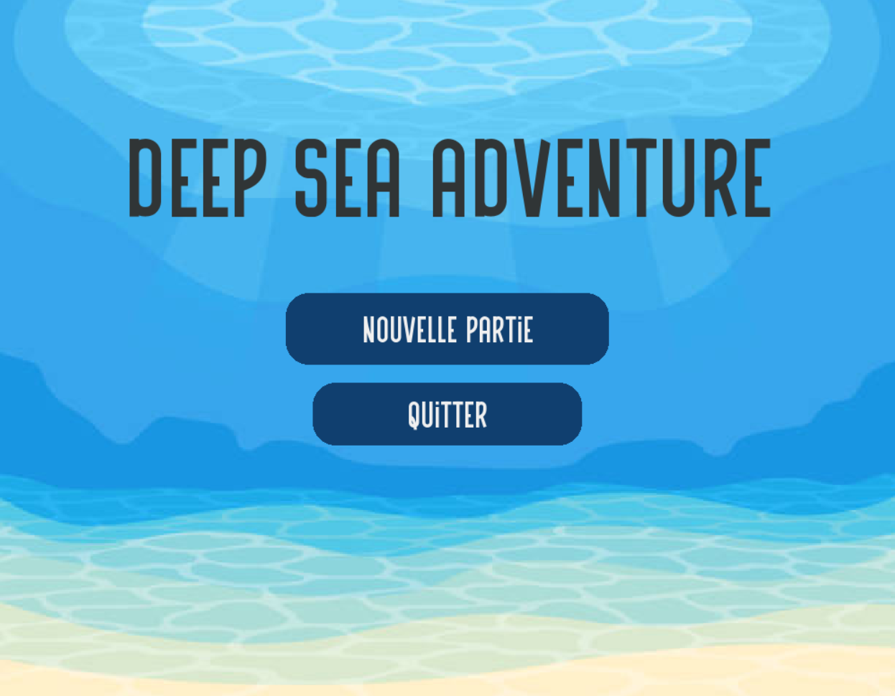
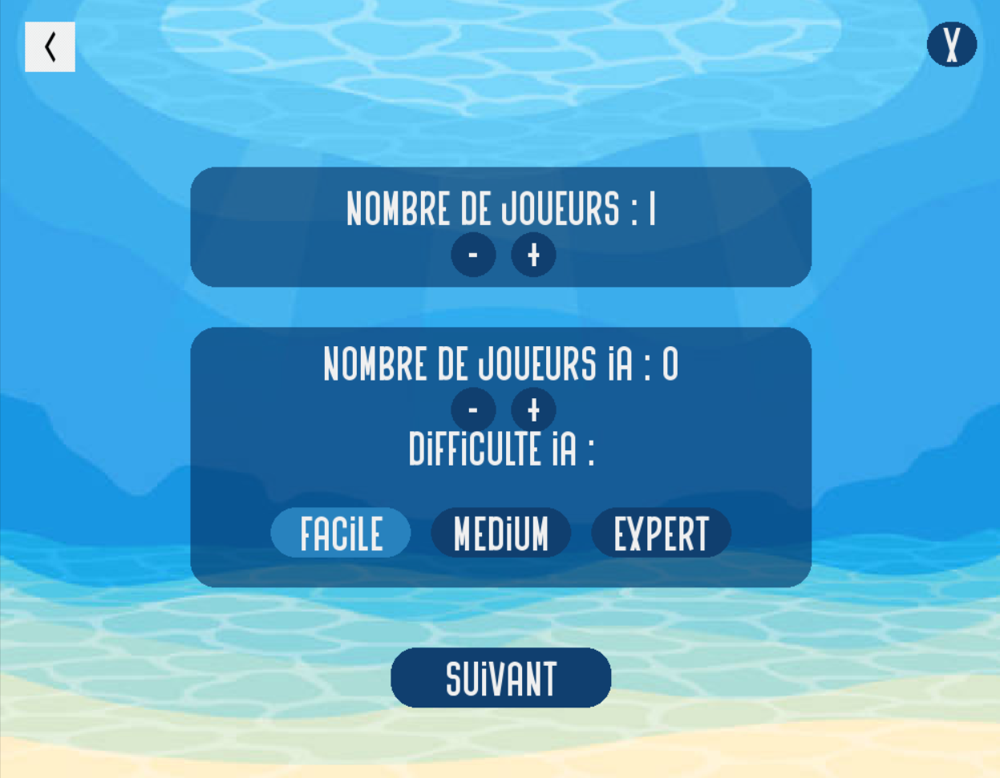
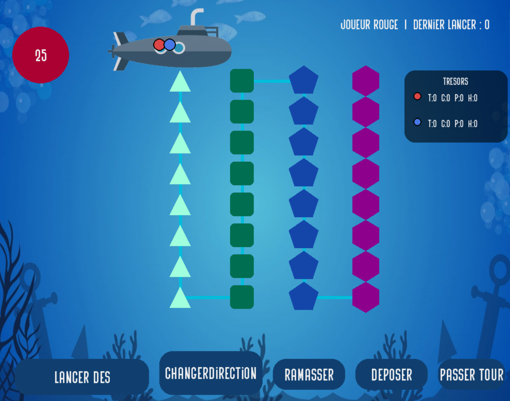
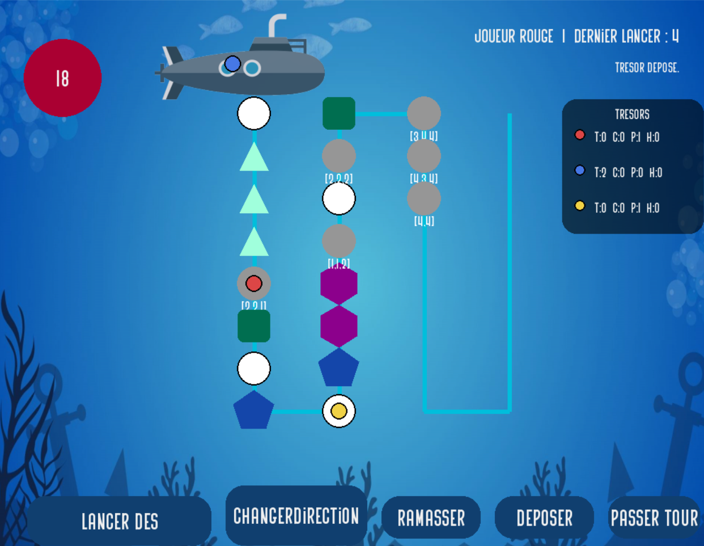

# 🌊 Deep Sea Adventure

Jeu de stratégie développé en **Python avec Pygame**, inspiré du jeu de société *Deep Sea Adventure*.

Les joueurs explorent les profondeurs pour récupérer des trésors. Mais l'oxygène est partagé, et chaque trésor transporté rend le retour plus difficile !

## 🎮 Aperçu du jeu

### Menu principal


### Configuration des joueurs


### Plateau initial


### Partie en cours


## ✨ Fonctionnalités

- Interface graphique interactive avec Pygame
- Joueurs humains et adversaires virtuels
- Trois niveaux d'IA : facile, medium et expert
- Déplacements et changements de direction
- Ramassage et dépôt de trésors, y compris des piles
- Gestion de l'oxygène partagé
- Suivi des trésors transportés
- Moteur de jeu orienté objet

## 🧭 Règles du jeu

Le but est de rapporter un maximum de trésors au sous-marin.

1. Les joueurs lancent les dés pour avancer.
2. Ils peuvent ramasser des trésors sur leur case.
3. Les trésors transportés ralentissent les déplacements et consomment de l'oxygène.
4. Chaque joueur doit choisir le bon moment pour faire demi-tour.
5. Les trésors rapportés au sous-marin permettent de marquer des points.

Les trésors sont répartis en quatre niveaux : triangle, carré, pentagone et hexagone.

## 🤖 Intelligence artificielle

| Difficulté | Stratégie |
|---|---|
| Facile | Décisions simples selon la charge et la position |
| Medium | Meilleure prise en compte de l'oxygène et du retour |
| Expert | Anticipation plus prudente des risques et sélection des trésors |

Les IA utilisent les informations visibles, sans consulter les valeurs cachées des trésors.

## 🛠️ Technologies

- Python
- Pygame
- Programmation orientée objet
- Algorithmique et heuristiques de décision

## 🚀 Installation

### Cloner le projet

```bash
git clone <URL_DU_DEPOT>
cd deepsea
```

### Créer un environnement virtuel

```bash
python -m venv .venv
```

Sur Windows (PowerShell) :

```powershell
.\.venv\Scripts\Activate.ps1
```

### Installer Pygame

```bash
python -m pip install pygame
```

### Lancer le jeu

```bash
python -m src.interface.interface
```

## 📁 Structure du projet

```text
deepsea/
├── assets/
├── images/
│   ├── menu.png
│   ├── configuration.png
│   ├── plateau.png
│   └── partie.png
├── src/
│   ├── engine/
│   │   ├── exception.py
│   │   ├── Jeton.py
│   │   ├── joueur.py
│   │   ├── manche.py
│   │   ├── partie.py
│   │   └── plateau.py
│   ├── interface/
│   │   ├── bouton.py
│   │   ├── interface.py
│   │   └── jeu.py
│   └── test.py
└── README.md
```

## 🎯 Objectifs

- Concevoir un moteur de jeu modulaire
- Appliquer la programmation orientée objet
- Développer une interface graphique
- Implémenter plusieurs stratégies d'intelligence artificielle
- Gérer les interactions entre joueurs et environnement

---


